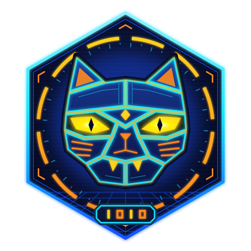
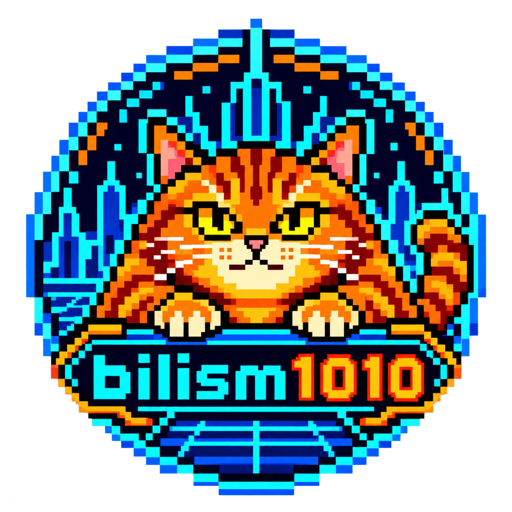

<p align="center">
  
</p>

<h1 align="center">
  
  GRIMALKIN 1010
</h1>

<p align="center">
  <b>Mine the rocks. Arm the bombs. Do not let them finish the cat.</b><br>
  An original two-mode arcade space shooter, built around the cyberpunk pixel-cat badge.
</p>

<p align="center">
  
  
  
  
</p>

Mine asteroids for **shards** and forge them into **Nipbombs** while enemy **Scrappers**
haul shards to a build site and assemble **GRIMALKIN** — a colossal biomechanical
cat-skull warship — out of 12 armour plates. When the last plate locks in, it wakes,
talks, and hunts you. Only Nipbombs hurt it, and it takes exactly 13.

One game, two renderers, switchable at any moment with **M** without touching game state:

| | RETRO | NEO 2.5D |
|---|---|---|
| Renderer | Canvas 2D, 480×360 buffer, nearest-neighbour upscale | WebGL2, tilted orthographic 2.5D |
| Look | Neon vector line art on pure black, phosphor trails, scanlines, aperture mask, CRT bezel | GGX PBR metal, dynamic point lights, screen-space gloss reflections, bloom, motion blur, volumetric thrusters, parallax nebula |
| Voice | Formant speech synth through a bit-crusher (8-bit speech-chip grit) | Same synth, wide, with sub layer and reverb |

The boss's eyes and mouth glow are driven every frame by the live amplitude and
spectrum of its synthesised voice. All audio is synthesised with the Web Audio API;
there are no sample files and no external libraries.

## Play

Open `index.html` in a recent Chrome, Edge, Safari or Firefox — or serve the folder:

```sh
python3 -m http.server 8765    # then http://127.0.0.1:8765/
```

| Key | Action |
|---|---|
| ← → / A D | Rotate left / right |
| ↑ / W | Thrust along the nose |
| ↓ / S | Brake, then slow reverse thrusters |
| Space / J | Fire bolts + short-range mining beam |
| B / K / Shift | Launch a Nipbomb (homes on Grimalkin) |
| M / Tab | Switch Retro ⇄ Neo |
| P / Esc, N | Pause, mute |
| Enter | Start |

| Controller (standard mapping) | Action |
|---|---|
| Left stick / d-pad | Fly: the ship turns and thrusts where you push |
| Right stick | Aim the nose independently and fire |
| A / right trigger | Fire bolts + mining beam |
| B / X / right bumper / left trigger | Launch a Nipbomb |
| Y | Switch Retro ⇄ Neo |
| Start, Back | Start / pause / resume, mute |

## Difficulty

Pick on the title screen with **1–4**, **← →**, the stick / d-pad, or the buttons. The choice is remembered.

| Level | Bombs to kill | Grimalkin | Build pace |
|---|---|---|---|
| Easy | 7 | Slow, lunges rarely, groggy for 6 s after waking | 4 deliveries per plate, fewer drones |
| Medium (default) | 10 | A bit slower and lazier than Hard, 4.5 s wake-up | 3 per plate |
| Hard | 13 | The original tuning, 3 s wake-up | 3 per plate |
| Ridiculous | 13 | Faster than your ship, lunges constantly | 2 per plate, extra drones |

Grimalkin talks a lot: it mutters while half-built and taunts every few seconds once awake.

**Space mice** turn up now and then (a 15% chance per spawn tick, at most three at once).
Fly over one to rescue it for 500 points and a Nipbomb. Being a cat, an awake Grimalkin
within range drops the hunt to chase the mouse instead — use that.

Touch is supported too (left half stick, right half fire, two-finger tap bombs). Tips: bolts cut shards out of rocks; fly over shards
to bank bombs (max 12). Shoot Scrappers carrying shards. Bombing the unfinished boss
knocks plates back off. Once it is awake, keep moving — it lunges faster than you fly.

Demo flags: `index.html?debug&mode=retro|neo&autostart&awake&bombs&god&mice&difficulty=easy|medium|hard|ridiculous`
(with `debug`, keys 9 / 8 / 0 add a plate / land a bomb hit / fill bombs).

## Tests

```sh
node tests/run.js
```

Headless suite over the real game scripts covering the three validation rules — mode
switches preserve all gameplay state, hunting activates exactly in `STATE_AWAKE`, and
exactly 13 discrete bomb hits destroy the boss (on Hard; 7 / 10 on Easy / Medium) — plus difficulty, space mice, wrap, mining, drone AI and
state-machine checks.

## Layout

```
index.html                  UI shell, HUD, bootloader
css/style.css               HUD + screens, Neo/Retro skins
css/retro-crt.css           CRT bezel and tube glass
js/core/Kernel.js           toroidal vector maths, base Entity, particles, beams
js/core/EngineBridge.js     game loop, physics, collisions, spawning, camera, HUD, mode toggle
js/core/StateManager.js     BOOT / ATTRACT / MINING / AWAKE / GAMEOVER
js/core/Input.js            49-way keyboard / gamepad / touch
js/core/AudioSynth.js       formant speech synth, sfx, distance-biased mixing
js/engines/RetroEngine.js   Canvas 2D vector monitor
js/engines/NeoEngine.js     WebGL2 PBR renderer
js/entities/PlayerShip.js   ship, bolts, Nipbombs
js/entities/Asteroid.js     rocks, yield + breakup tables, shards
js/entities/Drones.js       Scrapper and Claw state machines
js/entities/Grimalkin.js    the boss: 12-plate assembly, hunting, taunts, 13-hit kill
docs/CONTRACT.md            interface contract between the bridge, renderers, audio and input
assets/brand/               logo, banner, social card, favicons, web manifest
```

## Brand assets

Everything in `assets/brand/` is original vector art, self-contained (no external fonts
or images), with PNG renders alongside.

| File | Use |
|---|---|
| `banner.svg` / `banner.png` | README and site hero (1280×400, PNG at 2×) |
| `social-card.svg` / `social-card.png` | Social preview / Open Graph card (1280×640) |
| `logo.svg` / `logo-512.png` | Full emblem |
| `logo-mark.svg` / `favicon.svg` | Simplified mark for small sizes |
| `favicon.ico`, `icon-16…512.png` | Browser tab, Apple touch (180), PWA (192, 512) |
| `site.webmanifest` | Install metadata |

<p align="center">
  
  &nbsp;&nbsp;&nbsp;
  
</p>

## License

Apache License 2.0 — see [LICENSE](LICENSE).
